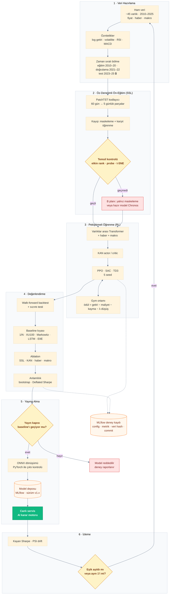

# AI Pipeline

> **Proje:** PortföyAI · **Sürüm:** 1.0 · **Hafta:** 1 · **İlgili:** [sistem_mimarisi.md](sistem_mimarisi.md) · [fonksiyonel_olmayan_isterler.md](../requirements/fonksiyonel_olmayan_isterler.md)

Bu diyagram, yapay zekâ modelinin **veriden yayına ve izlemeye kadar** olan yaşam döngüsünü gösterir. Günlük öneri üretimi (çıkarım) [sistem_mimarisi.md](sistem_mimarisi.md) içindeki *AI Karar Motoru* bölümünde anlatılmıştır; bu doküman modelin **nasıl üretildiğini, doğrulandığını ve güncellendiğini** anlatır.

| Aşama | Ne yapılır? | İlgili isterler |
|---|---|---|
| **1 · Veri Hazırlama** | Ham veri toplanır, öznitelikler çıkarılır, veri zaman sırasıyla bölünür; test seti kilitlenir. | NFR-022 – 026, NFR-030 |
| **2 · SSL Ön-Eğitim** | Kodlayıcı etiketsiz veriyle piyasanın yapısını öğrenir; temsil kalitesi kontrol edilir, yetersizse B planına geçilir. | Öneri formu · Risk İP4 |
| **3 · RL Eğitimi** | Ajan, simülasyon ortamında ödül ve ceza alarak portföy dağıtmayı öğrenir; her yapılandırma 5 seed ile eğitilir. | NFR-029, NFR-033, NFR-045 |
| **4 · Değerlendirme** | Walk-forward backtest, sızıntı testi, baseline kıyası, ablation ve istatistiksel anlamlılık. | NFR-027 – 036 |
| **5 · Yayına Alma** | Baseline'ı geçemeyen model reddedilir; geçen model ONNX'e çevrilip sürümlenir ve yayına alınır. | NFR-032, NFR-040, NFR-051 |
| **6 · İzleme** | Canlı performans ve drift izlenir; eşik aşılırsa veya ayın 1'inde döngü baştan başlar. | FR-118 – 123 |