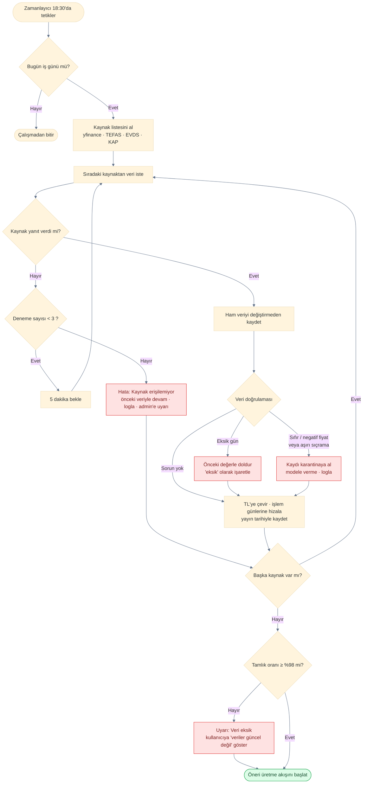
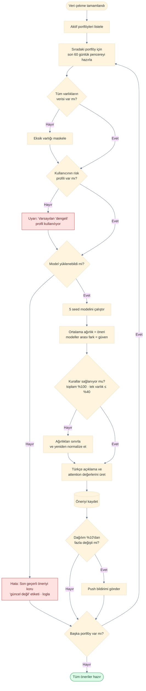
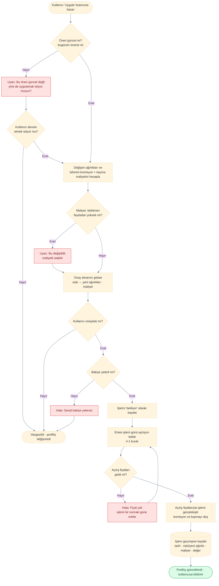
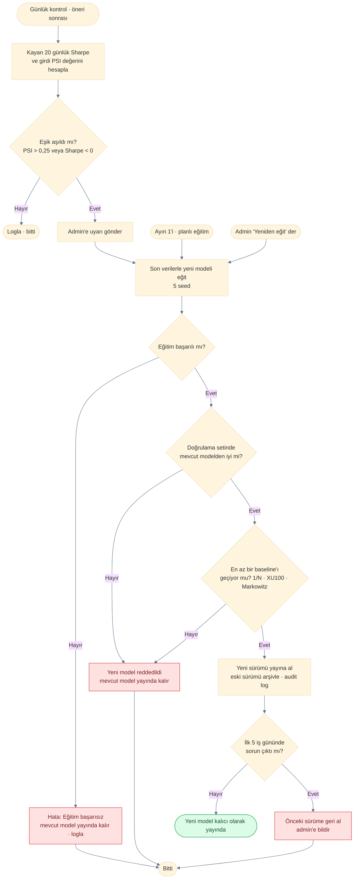

# Akış Diyagramları

> **Proje:** PortföyAI · **Sürüm:** 1.0 · **Hafta:** 1 · **İlgili:** [use_case.md](use_case.md) · [sistem_mimarisi.md](sistem_mimarisi.md)

Bu doküman, sistemin kritik süreçlerini adım adım ve **hata dallarıyla** birlikte gösterir.

| Şekil | Anlamı |
|---|---|
| Oval | Başlangıç / bitiş |
| Dikdörtgen | İşlem adımı |
| Eşkenar dörtgen | Karar (soru) |
| 🟥 Kırmızı kutu | Hata veya uyarı durumu |
| 🟩 Yeşil oval | Başarılı bitiş |

## Akış 1: Kayıt ve İki Aşamalı Giriş

**İlgili:** UC-02 · FR-006 – FR-010

```mermaid
%%{init: {'theme':'base', 'themeVariables': {'fontFamily':'Arial', 'lineColor':'#64748B'}}}%%
flowchart TD
    S([Kullanıcı giriş ekranını açar]) --> A[E-posta veya telefon + şifre girer]
    A --> B{Hesap 5 hatalı deneme<br/>nedeniyle kilitli mi?}
    B -- Evet --> E1[Hata: 15 dakika sonra tekrar dene]
    E1 --> X([Bitti])
    B -- Hayır --> C{Bilgiler doğru mu?}
    C -- Hayır --> E2[Hata: Bilgiler hatalı<br/>deneme sayacı +1]
    E2 --> A
    C -- Evet --> D{Giriş kanalı?}
    D -- E-posta --> K1[E-postaya 6 haneli kod gönder]
    D -- Telefon --> K2[SMS ile 6 haneli kod gönder]
    K2 --> SMS{SMS servisi<br/>çalışıyor mu?}
    SMS -- Hayır --> E3[Uyarı: SMS gönderilemedi<br/>kodu e-postayla gönder]
    E3 --> K1
    SMS -- Evet --> G
    K1 --> G[Kullanıcı kodu girer]
    G --> H{Kod süresi<br/>5 dakikayı geçti mi?}
    H -- Evet --> E4[Hata: Kodun süresi doldu<br/>Tekrar gönder]
    E4 --> D
    H -- Hayır --> I{Kod doğru mu?}
    I -- Hayır --> E5[Hata: Kod hatalı<br/>deneme sayacı +1]
    E5 --> L{Deneme sayısı<br/>5'e ulaştı mı?}
    L -- Hayır --> G
    L -- Evet --> KL[Hesabı 15 dakika kilitle]
    KL --> E1
    I -- Evet --> J[Token oluştur<br/>sayacı sıfırla]
    J --> Y([Ana sayfa açılır])

    classDef err fill:#FEE2E2,stroke:#DC2626,color:#7F1D1D
    classDef ok fill:#DCFCE7,stroke:#16A34A,color:#14532D
    Kod hatalı → sayaç +1 → 5 oldu mu?
                 ├─ Hayır → tekrar dene
                 └─ Evet → hesabı kilitle → "15 dakika sonra tekrar dene"
    class Y ok
```

## Akış 2: Günlük Veri Çekme ve Doğrulama

**İlgili:** UC-40 · FR-102 – FR-106 · NFR-022 – NFR-026



## Akış 3: Öneri Üretme

**İlgili:** UC-42, UC-43 · FR-109 – FR-113 · NFR-004, NFR-005



## Akış 4: Öneriyi Onayla ve Uygula

**İlgili:** UC-14 · FR-033 – FR-036 · NFR-027, NFR-029



## Akış 5: Drift Kontrolü ve Yeniden Eğitim

**İlgili:** UC-47, UC-49 · FR-118 – FR-123 · NFR-032, NFR-051

