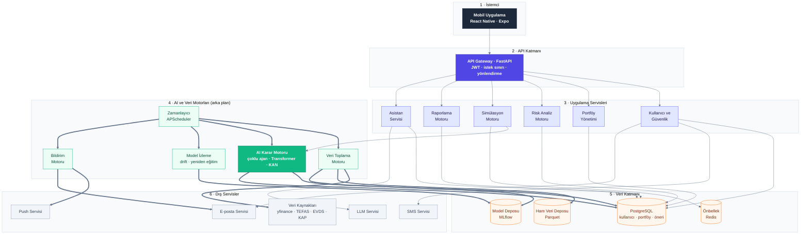
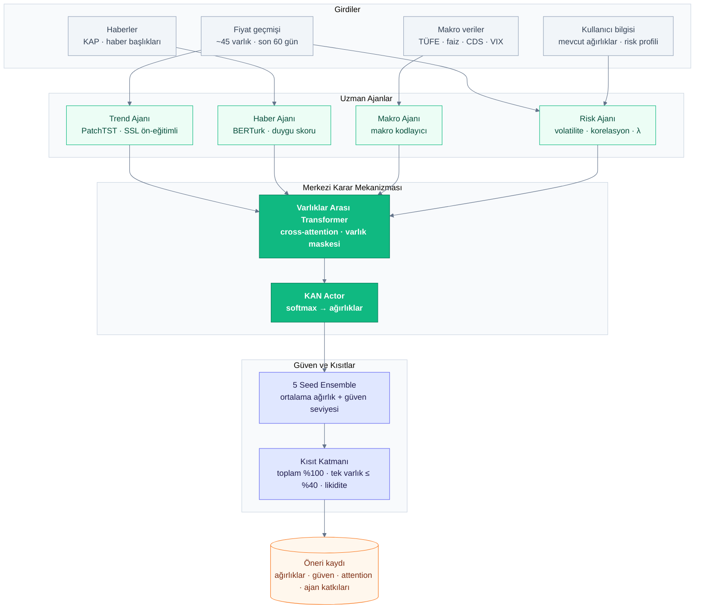

# Sistem Mimarisi

> **Proje:** PortföyAI · **Sürüm:** 1.0 · **Hafta:** 1 · **İlgili:** [use_case.md](use_case.md) · [fonksiyonel_isterler.md](../requirements/fonksiyonel_isterler.md)

PortföyAI; mobil istemci, API katmanı, uygulama servisleri, AI ve veri motorları, veri katmanı ve dış servislerden oluşan katmanlı bir mimariye sahiptir. Sistemde iki ana akış vardır:

- **Kullanıcı akışı (düz oklar):** Gün boyunca çalışır, hızlıdır, çoğunlukla hazır sonuçları okur.
- **Arka plan akışı (kalın oklar):** Her iş günü 18:30'da çalışır; veri toplama, öneri üretimi ve bildirimleri yapar.

## Genel Mimari

## AI Karar Motoru (Çoklu Ajan Sistemi)

AI karar motoru, her biri farklı bir bilgi türünde uzmanlaşmış dört ajandan ve bu ajanların çıktılarını birleştiren merkezi bir karar mekanizmasından oluşur. Kullanıcı bu motoru doğrudan görmez; yalnızca sonuçlarını (öneri, güven seviyesi, açıklama, ajan katkıları) görür.

| Bileşen | Görevi |
|---|---|
| **Trend Ajanı** | Fiyat hareketlerini ve trendleri öğrenir. Etiketsiz veriyle önceden eğitilmiş (SSL) PatchTST kodlayıcısıdır. |
| **Haber Ajanı** | KAP duyurularını ve haber başlıklarını BERTurk ile olumlu / olumsuz olarak değerlendirir. |
| **Makro Ajanı** | Enflasyon, faiz, CDS ve VIX gibi ekonomik göstergelerden piyasanın genel durumunu çıkarır. |
| **Risk Ajanı** | Oynaklık, korelasyon ve kullanıcının risk profilinden (λ) ne kadar risk alınabileceğini belirler. |
| **Varlıklar Arası Transformer** | Dört ajanın çıktısını birleştirir; her varlığı bir token olarak ele alıp varlıklar arasındaki ilişkiyi öğrenir. Verisi olmayan varlıklar maskelenir. |
| **KAN Actor** | Her varlık için bir skor üretir; skorlar softmax ile toplamı %100 olan ağırlıklara dönüşür. |
| **5 Seed Ensemble** | Farklı başlangıçlarla eğitilmiş 5 model çalıştırılır; ortalama ağırlık öneri, aralarındaki fark güven seviyesi olur. |
| **Kısıt Katmanı** | Ağırlık toplamı, tek varlık sınırı ve likidite kurallarını uygular. |