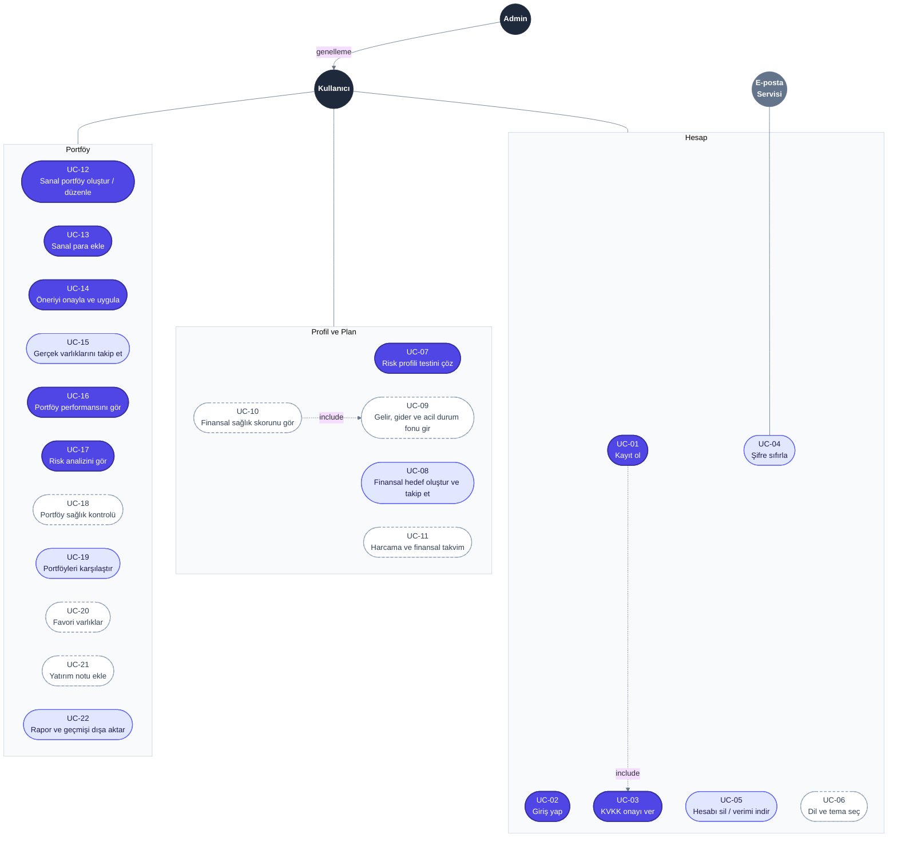
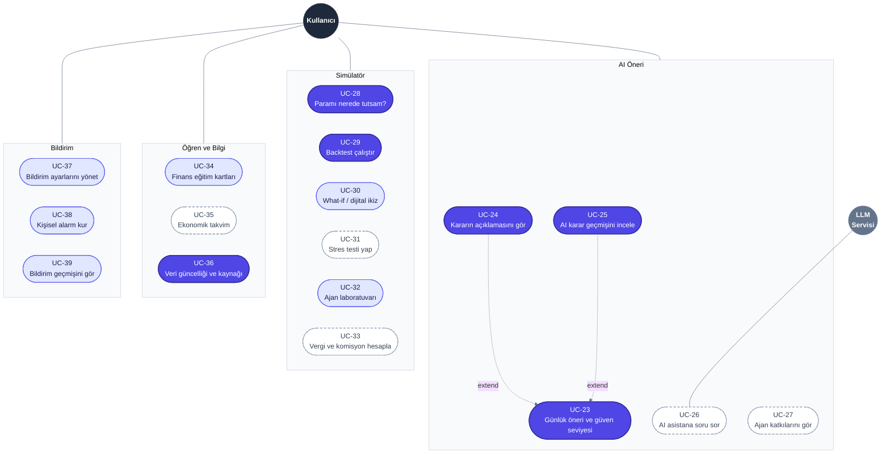
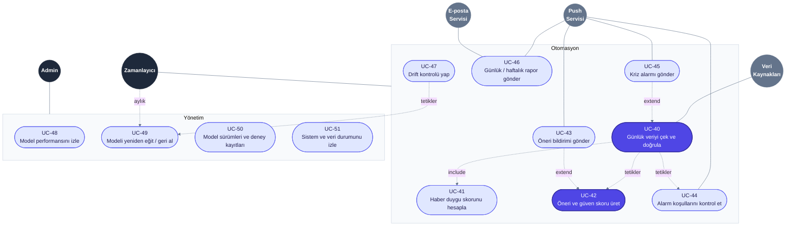

# Use Case Diyagramı

> **Proje:** PortföyAI (mobil uygulama) · **Sürüm:** 2.0 · **Hafta:** 1

Bu doküman, PortföyAI sistemiyle etkileşime giren aktörleri ve her aktörün gerçekleştirdiği kullanım durumlarını gösterir. Her kullanım durumu **MoSCoW** yöntemiyle önceliklendirilmiştir.

> Bu doküman yalnızca aktörlerin **ne yapabildiğini** gösterir. İşlerin hangi ekranda yapıldığı `docs/mockups/` klasöründe, arka planda hangi modüllerin çalıştığı ise `sistem_mimarisi.md` dosyasında yer alır.

## Öncelik (MoSCoW)

| Etiket | Diyagramdaki görünüm | Anlamı |
|---|---|---|
| 🔴 **Must** | Koyu mavi dolu kutu | 7. hafta MVP'sinde mutlaka olmalı |
| 🟡 **Should** | Açık mavi kutu | Ders teslimine kadar yapılması hedeflenir |
| ⚪ **Could** | Beyaz, kesikli çerçeve | Zaman kalırsa yapılır, kalmazsa sonraki sürüme aktarılır |

## 1. Kullanıcı Tarafı – Hesap, Profil ve Portföy

## 2. Kullanıcı Tarafı – AI Öneri, Simülatör, Öğren ve Bildirim

## 3. Sistem Tarafı – Otomasyon ve Yönetim

## Gösterim

| Öğe | Anlamı |
|---|---|
| Koyu daire | Birincil aktör (sistemi başlatan kişi veya servis) |
| Gri daire | İkincil aktör (sistemin iletişim kurduğu dış sistem) |
| Kutu | İşlevsel grup |
| Düz çizgi | Aktör ile kullanım durumu (veya grubu) arasındaki ilişki |
| `include` | Temel iş yapıldığında bu iş de **her zaman** yapılır |
| `extend` | Bu iş, temel işe **koşullu / isteğe bağlı** olarak eklenir |
| `tetikler` | Bir iş tamamlandığında diğerini otomatik başlatır |
| `genelleme` | Admin, Kullanıcı'nın tüm yeteneklerine sahiptir (kalıtım) |

> **Not:** Klasik UML'de aktör her kullanım durumuna ayrı ayrı bağlanır. 51 kullanım durumu olduğu için okunabilirliği artırmak amacıyla aktörler işlevsel gruplara bağlanmıştır. Bir aktörün gruba bağlı olması, o gruptaki tüm işleri yapabildiği anlamına gelir.

## Aktörler

| Aktör | Tür | Açıklama |
|---|---|---|
| **Kullanıcı** | Birincil · insan | Mobil uygulamayı kullanan bireysel yatırımcı |
| **Admin** | Birincil · insan | Model ve sistem durumunu yöneten kullanıcı; Kullanıcı'nın tüm yeteneklerine de sahiptir |
| **Zamanlayıcı** | Birincil · sistem | Veri çekme, öneri üretme, alarm kontrolü, raporlama, drift kontrolü ve aylık yeniden eğitimi başlatan servis (APScheduler) |
| **Veri Kaynakları** | İkincil · dış sistem | yfinance, TEFAS, TCMB EVDS ve KAP |
| **Push Servisi** | İkincil · dış sistem | Telefona bildirim ileten servis (Expo Push) |
| **E-posta Servisi** | İkincil · dış sistem | Şifre sıfırlama ve haftalık rapor e-postalarını ileten servis |
| **LLM Servisi** | İkincil · dış sistem | AI asistanın cevaplarını, yalnızca sistemin verdiği gerçek verilerle Türkçe metne dönüştüren dil modeli API'si |

## Kullanım Durumları

| ID | Kullanım Durumu | Aktör | Grup | Öncelik | Kısa Açıklama |
|---|---|---|---|---|---|
| UC-01 | Kayıt ol | Kullanıcı | Hesap | 🔴 Must | E-posta ve şifre ile hesap oluşturma |
| UC-02 | Giriş yap | Kullanıcı | Hesap | 🔴 Must | JWT ile oturum açma |
| UC-03 | KVKK onayı ver | Kullanıcı | Hesap | 🔴 Must | Kayıtta aydınlatma metni ve "yatırım tavsiyesi değildir" uyarısının onaylanması |
| UC-04 | Şifre sıfırla | Kullanıcı, E-posta Servisi | Hesap | 🟡 Should | E-postaya gönderilen bağlantı ile yeni şifre belirleme |
| UC-05 | Hesabı sil / verimi indir | Kullanıcı | Hesap | 🟡 Should | KVKK kapsamında kişisel verilerin indirilmesi veya silinmesi |
| UC-06 | Dil ve tema seç | Kullanıcı | Hesap | ⚪ Could | Türkçe / İngilizce / Arapça; karanlık / aydınlık tema |
| UC-07 | Risk profili testini çöz | Kullanıcı | Profil ve Plan | 🔴 Must | 6 soruluk test; modelin risk katsayısını belirler |
| UC-08 | Finansal hedef oluştur ve takip et | Kullanıcı | Profil ve Plan | 🟡 Should | Birden fazla hedef; gereken aylık birikim ve enflasyona göre gelecekteki maliyet |
| UC-09 | Gelir, gider ve acil durum fonu gir | Kullanıcı | Profil ve Plan | ⚪ Could | Aylık gelir-gider; 3-6 aylık gider karşılığı acil durum fonu hedefi |
| UC-10 | Finansal sağlık skorunu gör | Kullanıcı | Profil ve Plan | ⚪ Could | Tasarruf, acil durum fonu, çeşitlendirme ve reel getiriden 0-100 kural tabanlı skor |
| UC-11 | Harcama ve finansal takvim | Kullanıcı | Profil ve Plan | ⚪ Could | Harcama kategorileri; maaş, kira, fatura tarihleri |
| UC-12 | Sanal portföy oluştur / düzenle | Kullanıcı | Portföy | 🔴 Must | Başlangıç sermayesi, varlık evreni ve ajan seçimi |
| UC-13 | Sanal para ekle | Kullanıcı | Portföy | 🔴 Must | Tek seferlik veya düzenli (aylık) sanal para ekleme |
| UC-14 | Öneriyi onayla ve uygula | Kullanıcı | Portföy | 🔴 Must | Maliyet özeti gösterilir; kullanıcı onaylarsa öneri sanal portföye uygulanır |
| UC-15 | Gerçek varlıklarını takip et | Kullanıcı | Portföy | 🟡 Should | Sahip olunan altın, döviz, hisse ve fonların elle girilmesi; uygulama para tutmaz |
| UC-16 | Portföy performansını gör | Kullanıcı | Portföy | 🔴 Must | Değer grafiği; nominal TL / reel TL / USD; XU100 ve enflasyon karşılaştırması |
| UC-17 | Risk analizini gör | Kullanıcı | Portföy | 🔴 Must | Volatilite, maks. düşüş, Sharpe, Sortino, VaR, korelasyon ve varlık yoğunlaşması |
| UC-18 | Portföy sağlık kontrolü | Kullanıcı | Portföy | ⚪ Could | Risk profiline uyum, aşırı yoğunlaşma ve tek faktöre bağımlılık raporu |
| UC-19 | Portföyleri karşılaştır | Kullanıcı | Portföy | 🟡 Should | Benim portföyüm / AI / sadece altın / XU100; getiri, maks. düşüş, Sharpe |
| UC-20 | Favori varlıklar | Kullanıcı | Portföy | ⚪ Could | Favori listesi ve iki varlığın aynı grafikte karşılaştırılması |
| UC-21 | Yatırım notu ekle | Kullanıcı | Portföy | ⚪ Could | Kullanıcının kararlarının nedenini not etmesi |
| UC-22 | Rapor ve geçmişi dışa aktar | Kullanıcı | Portföy | 🟡 Should | İşlem geçmişi ve raporların CSV / Excel / PDF olarak indirilmesi |
| UC-23 | Günlük öneri ve güven seviyesi | Kullanıcı | AI Öneri | 🔴 Must | Önerilen ağırlıklar; 5 seed modelin uyumundan hesaplanan güven seviyesi |
| UC-24 | Kararın açıklamasını gör | Kullanıcı | AI Öneri | 🔴 Must | Değişim özeti, Türkçe yorum, attention haritası, KAN eğrileri |
| UC-25 | AI karar geçmişini incele | Kullanıcı | AI Öneri | 🔴 Must | Geçmiş kararlar, nedenleri ve sonuçları |
| UC-26 | AI asistana soru sor | Kullanıcı, LLM Servisi | AI Öneri | ⚪ Could | Cevaplar yalnızca kullanıcının gerçek verileri ve model çıktılarıyla üretilir |
| UC-27 | Ajan katkılarını gör | Kullanıcı | AI Öneri | ⚪ Could | Trend, risk, haber ve makro bileşenlerinin karara katkısı |
| UC-28 | Paramı nerede tutsam? | Kullanıcı | Simülatör | 🔴 Must | Aynı paranın yastık altı, mevduat, altın, dolar ve PortföyAI ile karşılaştırılması; düzenli birikim |
| UC-29 | Backtest çalıştır | Kullanıcı | Simülatör | 🔴 Must | Geçmiş dönemde ajanın XU100 ve diğer yöntemlerle karşılaştırılması |
| UC-30 | What-if / dijital ikiz | Kullanıcı | Simülatör | 🟡 Should | Gerçek portföyü değiştirmeden alternatif dağılımların denenmesi |
| UC-31 | Stres testi yap | Kullanıcı | Simülatör | ⚪ Could | "Dolar %20 artarsa?" gibi şokların portföye tahmini etkisi |
| UC-32 | Ajan laboratuvarı | Kullanıcı | Simülatör | 🟡 Should | PPO / SAC / TD3, KAN / MLP, SSL var / yok sonuçlarının karşılaştırılması |
| UC-33 | Vergi ve komisyon hesapla | Kullanıcı | Simülatör | ⚪ Could | Komisyon, stopaj, spread sonrası tahmini net getiri |
| UC-34 | Finans eğitim kartları | Kullanıcı | Öğren ve Bilgi | 🟡 Should | 1 dakikalık kartlar, mini testler, finans sözlüğü |
| UC-35 | Ekonomik takvim | Kullanıcı | Öğren ve Bilgi | ⚪ Could | TCMB, TÜİK, FED kararları; önceki ve beklenen değer |
| UC-36 | Veri güncelliği ve kaynağı | Kullanıcı | Öğren ve Bilgi | 🔴 Must | Son güncelleme zamanı, kaynak, eksik veri durumu, modelin eğitim tarihi |
| UC-37 | Bildirim ayarlarını yönet | Kullanıcı | Bildirim | 🟡 Should | Öneri, kriz, alarm ve rapor bildirimlerini açma-kapama |
| UC-38 | Kişisel alarm kur | Kullanıcı | Bildirim | 🟡 Should | "Altın %3 düşerse", "reel getirim negatife düşerse" gibi kurallar |
| UC-39 | Bildirim geçmişini gör | Kullanıcı | Bildirim | 🟡 Should | Gelen tüm bildirimlerin listesi |
| UC-40 | Günlük veriyi çek ve doğrula | Zamanlayıcı, Veri Kaynakları | Otomasyon | 🔴 Must | 18:30'da veri alımı; eksik ve hatalı fiyat tespiti |
| UC-41 | Haber duygu skorunu hesapla | Zamanlayıcı | Otomasyon | 🟡 Should | KAP / haber başlıklarının BERTurk ile işlenmesi |
| UC-42 | Öneri ve güven skoru üret | Zamanlayıcı | Otomasyon | 🔴 Must | Her portföy için yeni ağırlıklar ve güven seviyesi |
| UC-43 | Öneri bildirimi gönder | Zamanlayıcı, Push Servisi | Otomasyon | 🟡 Should | Dağılım önemli ölçüde değişince telefona bildirim |
| UC-44 | Alarm koşullarını kontrol et | Zamanlayıcı, Push Servisi | Otomasyon | 🟡 Should | Kişisel alarmların kontrol edilip tetiklenmesi |
| UC-45 | Kriz alarmı gönder | Zamanlayıcı, Push Servisi | Otomasyon | 🟡 Should | Dolar, CDS veya VIX ani sıçradığında uyarı |
| UC-46 | Günlük / haftalık rapor gönder | Zamanlayıcı, Push Servisi, E-posta Servisi | Otomasyon | 🟡 Should | Günlük kısa özet (push), haftalık rapor (e-posta) |
| UC-47 | Drift kontrolü yap | Zamanlayıcı | Otomasyon | 🟡 Should | Kayan Sharpe ve PSI ile günlük model kontrolü |
| UC-48 | Model performansını izle | Admin | Yönetim | 🟡 Should | Canlı performans ve drift uyarıları |
| UC-49 | Modeli yeniden eğit / geri al | Admin, Zamanlayıcı | Yönetim | 🟡 Should | Admin elle; Zamanlayıcı ayda bir veya drift tetiklemesiyle |
| UC-50 | Model sürümleri ve deney kayıtları | Admin | Yönetim | 🟡 Should | MLflow deney kayıtları ve yayındaki model sürümü |
| UC-51 | Sistem ve veri durumunu izle | Admin | Yönetim | 🟡 Should | Son veri çekme zamanı, hatalar ve servis durumu |

## İlişkiler

| İlişki | Tür | Anlamı |
|---|---|---|
| UC-01 → UC-03 | include | Kayıt sırasında KVKK onayı zorunludur |
| UC-10 → UC-09 | include | Sağlık skoru, gelir-gider bilgisi olmadan hesaplanamaz |
| UC-24 → UC-23 | extend | Kullanıcı öneriye bakarken isterse açıklamayı açar |
| UC-25 → UC-23 | extend | Kullanıcı öneriden geçmiş kararlara geçebilir |
| UC-40 → UC-41 | include | Veri çekilirken haber duygu skoru da her zaman hesaplanır |
| UC-40 → UC-42 | tetikler | Veri çekildikten sonra öneri üretimi otomatik başlar |
| UC-43 → UC-42 | extend | Bildirim yalnızca dağılım önemli ölçüde değiştiğinde gönderilir |
| UC-40 → UC-44 | tetikler | Yeni veriyle kişisel alarmlar kontrol edilir |
| UC-45 → UC-40 | extend | Veride ani sıçrama tespit edilirse kriz alarmı gönderilir |
| UC-47 → UC-49 | tetikler | Drift eşiği aşılırsa yeniden eğitim başlatılır |
| Zamanlayıcı → UC-49 | aylık | Model ayda bir planlı olarak yeniden eğitilir |
| Admin → Kullanıcı | genelleme | Admin, Kullanıcı'nın tüm kullanım durumlarını da gerçekleştirebilir |

## Öncelik Özeti

| Grup | 🔴 Must | 🟡 Should | ⚪ Could | Toplam |
|---|---|---|---|---|
| Hesap | 3 | 2 | 1 | 6 |
| Profil ve Plan | 1 | 1 | 3 | 5 |
| Portföy | 5 | 3 | 3 | 11 |
| AI Öneri | 3 | 0 | 2 | 5 |
| Simülatör | 2 | 2 | 2 | 6 |
| Öğren ve Bilgi | 1 | 1 | 1 | 3 |
| Bildirim | 0 | 3 | 0 | 3 |
| Otomasyon | 2 | 6 | 0 | 8 |
| Yönetim | 0 | 4 | 0 | 4 |
| **Toplam** | **17** | **22** | **12** | **51** |

## Sürüm Notları

**v2.0:** Proje web uygulamasından **mobil uygulamaya** taşındı. Telegram botu yerine **push bildirimi** kullanılıyor. Finansal hedef, sağlık skoru, risk analizi, AI güven seviyesi, karar geçmişi, AI asistan, what-if / dijital ikiz, stres testi, kişisel alarm, ekonomik takvim ve veri güncelliği özellikleri eklendi. Tüm kullanım durumları MoSCoW ile önceliklendirildi. Çoklu ajan sistemi bir arka plan modülü olduğu için use case yerine sistem mimarisinde ele alınıyor.