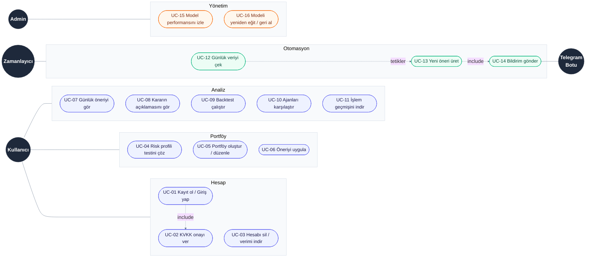

# Use Case Diyagramı

> **Proje:** PortföyAI · **Sürüm:** 1.0 · **Hafta:** 1

Bu doküman, PortföyAI sistemiyle etkileşime giren aktörleri ve her aktörün sistem üzerinde gerçekleştirdiği kullanım durumlarını (use case) gösterir. Kullanım durumları okunabilirlik için beş işlevsel gruba ayrılmıştır.

## Diyagram

Mermaid kaynak kodu

**Gösterim:**
- **Koyu daireler:** aktörler (sistemin dışındaki kişi veya sistemler)
- **Kutular:** işlevsel gruplar
- **Düz çizgi:** aktörün o gruptaki işleri yaptığını gösterir
- **Kesikli ok (`include`):** bir iş yapıldığında diğerinin de mutlaka yapıldığını gösterir
- **Renkler:** mavi = kullanıcı işlemleri · yeşil = otomatik işlemler · turuncu = yönetici işlemleri

## Aktörler

| Aktör | Tür | Açıklama |
|---|---|---|
| **Kullanıcı** | İnsan | Uygulamaya kayıt olan, portföy oluşturan ve önerileri takip eden bireysel yatırımcı |
| **Zamanlayıcı** | Sistem | Her iş günü 18:30'da veri çekme ve öneri üretme işlerini otomatik başlatan servis (APScheduler) |
| **Admin** | İnsan | Model performansını izleyen, gerektiğinde modeli yeniden eğiten veya eski sürüme geri alan yönetici |
| **Telegram Botu** | Dış sistem | Öneri değiştiğinde kullanıcıya bildirim ileten dış servis |

## Kullanım Durumları

| ID | Kullanım Durumu | Aktör | Grup | Kısa Açıklama |
|---|---|---|---|---|
| UC-01 | Kayıt ol / Giriş yap | Kullanıcı | Hesap | E-posta ve şifre ile hesap oluşturma, JWT ile oturum açma |
| UC-02 | KVKK onayı ver | Kullanıcı | Hesap | İlk girişte aydınlatma metni ve "yatırım tavsiyesi değildir" uyarısının onaylanması |
| UC-03 | Hesabı sil / verimi indir | Kullanıcı | Hesap | KVKK kapsamında kişisel verilerin indirilmesi veya tamamen silinmesi |
| UC-04 | Risk profili testini çöz | Kullanıcı | Portföy | Kısa test ile düşük / orta / yüksek risk profilinin belirlenmesi |
| UC-05 | Portföy oluştur / düzenle | Kullanıcı | Portföy | Sermaye, varlık ve ajan seçerek sanal portföy oluşturma |
| UC-06 | Öneriyi uygula | Kullanıcı | Portföy | Günlük önerinin komisyon ve kayma düşülerek sanal portföye uygulanması |
| UC-07 | Günlük öneriyi gör | Kullanıcı | Analiz | Ajanın önerdiği ağırlık dağılımının grafikle gösterilmesi |
| UC-08 | Kararın açıklamasını gör | Kullanıcı | Analiz | Attention haritası, KAN eğrileri ve Türkçe yorum |
| UC-09 | Backtest çalıştır | Kullanıcı | Analiz | Seçilen dönemde ajanın XU100 ve diğer yöntemlerle karşılaştırılması |
| UC-10 | Ajanları karşılaştır | Kullanıcı | Analiz | Tüm deney ve ablation sonuçlarının tablo halinde gösterilmesi |
| UC-11 | İşlem geçmişini indir | Kullanıcı | Analiz | Sanal işlem geçmişinin CSV olarak indirilmesi |
| UC-12 | Günlük veriyi çek | Zamanlayıcı | Otomasyon | yfinance, TEFAS ve EVDS'ten günlük verinin alınıp veritabanına yazılması |
| UC-13 | Yeni öneri üret | Zamanlayıcı | Otomasyon | Güncel veriyle her portföy için yeni ağırlıkların hesaplanması |
| UC-14 | Bildirim gönder | Telegram Botu | Otomasyon | Dağılım önemli ölçüde değiştiğinde kullanıcıya mesaj gönderilmesi |
| UC-15 | Model performansını izle | Admin | Yönetim | Kayan Sharpe ve drift (PSI) değerlerinin takip edilmesi |
| UC-16 | Modeli yeniden eğit / geri al | Admin | Yönetim | Performans düşünce yeni modelin eğitilmesi veya eski sürüme dönülmesi |

## İlişkiler

| İlişki | Tür | Anlamı |
|---|---|---|
| UC-01 → UC-02 | include | Kayıt sırasında KVKK onayı zorunludur |
| UC-12 → UC-13 | tetikler | Veri çekildikten sonra öneri üretimi otomatik başlar |
| UC-13 → UC-14 | include | Yeni öneri üretildiğinde bildirim adımı her zaman çalışır |
