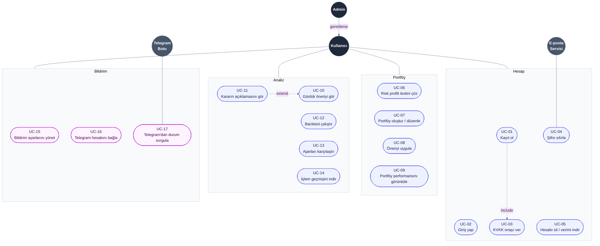
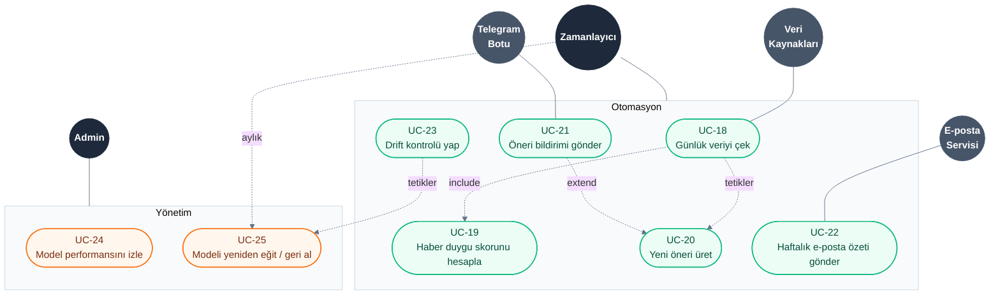

# Use Case Diyagramı

> **Proje:** PortföyAI · **Sürüm:** 1.3 · **Hafta:** 1

Bu doküman, PortföyAI sistemiyle etkileşime giren aktörleri ve her aktörün sistem üzerinde gerçekleştirdiği kullanım durumlarını (use case) gösterir. Okunabilirlik için diyagram iki parçaya ayrılmıştır:

1. **Kullanıcı tarafı:** kullanıcının arayüz üzerinden yaptığı işler
2. **Sistem tarafı:** otomatik çalışan işler, model yönetimi ve dış sistemler

## 1. Kullanıcı Tarafı

## 2. Sistem Tarafı

## Gösterim

| Öğe | Anlamı |
|---|---|
| Koyu daire | Birincil aktör (sistemi başlatan kişi veya servis) |
| Gri daire | İkincil aktör (sistemin iletişim kurduğu dış sistem) |
| Kutu | İşlevsel grup |
| Düz çizgi | Aktör ile kullanım durumu (veya grubu) arasındaki ilişki |
| `include` | Temel iş yapıldığında bu iş de **her zaman** yapılır |
| `extend` | Bu iş, temel işe **koşullu / isteğe bağlı** olarak eklenir |
| `tetikler` | Bir iş tamamlandığında diğerini otomatik başlatır |
| `genelleme` | Admin, Kullanıcı'nın tüm yeteneklerine sahiptir (kalıtım) |

> **Not:** Klasik UML'de aktör her kullanım durumuna ayrı ayrı bağlanır. 25 kullanım durumu olduğu için okunabilirliği artırmak amacıyla aktörler işlevsel gruplara bağlanmıştır; bir aktörün gruba bağlı olması, o gruptaki tüm işleri yapabildiği anlamına gelir.

## Aktörler

| Aktör | Tür | Açıklama |
|---|---|---|
| **Kullanıcı** | Birincil · insan | Uygulamaya kayıt olan, portföy oluşturan ve önerileri takip eden bireysel yatırımcı |
| **Admin** | Birincil · insan | Model performansını izleyen ve modeli yöneten kullanıcı; Kullanıcı'nın tüm yeteneklerine de sahiptir |
| **Zamanlayıcı** | Birincil · sistem | Veri çekme, öneri üretme, drift kontrolü, özet gönderimi ve aylık yeniden eğitimi otomatik başlatan servis (APScheduler) |
| **Veri Kaynakları** | İkincil · dış sistem | yfinance, TEFAS, TCMB EVDS ve KAP |
| **Telegram Botu** | İkincil · dış sistem | Kullanıcıya bildirim gönderen ve komutlara yanıt veren servis |
| **E-posta Servisi** | İkincil · dış sistem | Haftalık özet ve şifre sıfırlama e-postalarını ileten servis |

## Kullanım Durumları

| ID | Kullanım Durumu | Aktör | Grup | Kısa Açıklama |
|---|---|---|---|---|
| UC-01 | Kayıt ol | Kullanıcı | Hesap | E-posta ve şifre ile hesap oluşturma |
| UC-02 | Giriş yap | Kullanıcı | Hesap | JWT ile oturum açma |
| UC-03 | KVKK onayı ver | Kullanıcı | Hesap | Kayıt sırasında aydınlatma metni ve "yatırım tavsiyesi değildir" uyarısının onaylanması |
| UC-04 | Şifre sıfırla | Kullanıcı, E-posta Servisi | Hesap | E-postaya gönderilen bağlantı ile yeni şifre belirleme |
| UC-05 | Hesabı sil / verimi indir | Kullanıcı | Hesap | KVKK kapsamında kişisel verilerin indirilmesi veya tamamen silinmesi |
| UC-06 | Risk profili testini çöz | Kullanıcı | Portföy | Kısa test ile düşük / orta / yüksek risk profilinin belirlenmesi |
| UC-07 | Portföy oluştur / düzenle | Kullanıcı | Portföy | Sermaye, varlık ve ajan seçerek sanal portföy oluşturma |
| UC-08 | Öneriyi uygula | Kullanıcı | Portföy | Günlük önerinin komisyon ve kayma düşülerek sanal portföye uygulanması |
| UC-09 | Portföy performansını görüntüle | Kullanıcı | Portföy | Portföy değeri, reel getiri ve XU100 karşılaştırması |
| UC-10 | Günlük öneriyi gör | Kullanıcı | Analiz | Ajanın önerdiği ağırlık dağılımının grafikle gösterilmesi |
| UC-11 | Kararın açıklamasını gör | Kullanıcı | Analiz | Attention haritası, KAN eğrileri ve Türkçe yorum |
| UC-12 | Backtest çalıştır | Kullanıcı | Analiz | Seçilen dönemde ajanın XU100 ve diğer yöntemlerle karşılaştırılması |
| UC-13 | Ajanları karşılaştır | Kullanıcı | Analiz | Tüm deney ve ablation sonuçlarının tablo halinde gösterilmesi |
| UC-14 | İşlem geçmişini indir | Kullanıcı | Analiz | Sanal işlem geçmişinin CSV olarak indirilmesi |
| UC-15 | Bildirim ayarlarını yönet | Kullanıcı | Bildirim | Telegram / e-posta bildirimlerini açma-kapama |
| UC-16 | Telegram hesabını bağla | Kullanıcı | Bildirim | `/start` komutu ile Telegram hesabının PortföyAI hesabına bağlanması |
| UC-17 | Telegram'dan durum sorgula | Kullanıcı, Telegram Botu | Bildirim | `/portfoy` komutu ile güncel portföy durumunun alınması |
| UC-18 | Günlük veriyi çek | Zamanlayıcı, Veri Kaynakları | Otomasyon | Her iş günü 18:30'da fiyat, fon ve makro verinin alınıp veritabanına yazılması |
| UC-19 | Haber duygu skorunu hesapla | Zamanlayıcı | Otomasyon | KAP / haber başlıklarının BERTurk ile işlenmesi |
| UC-20 | Yeni öneri üret | Zamanlayıcı | Otomasyon | Güncel veriyle her portföy için yeni ağırlıkların hesaplanması |
| UC-21 | Öneri bildirimi gönder | Zamanlayıcı, Telegram Botu | Otomasyon | Dağılım önemli ölçüde değiştiğinde kullanıcıya mesaj gönderilmesi |
| UC-22 | Haftalık e-posta özeti gönder | Zamanlayıcı, E-posta Servisi | Otomasyon | Haftalık portföy performans özetinin gönderilmesi |
| UC-23 | Drift kontrolü yap | Zamanlayıcı | Otomasyon | Kayan Sharpe ve PSI ile model performansının günlük kontrolü |
| UC-24 | Model performansını izle | Admin | Yönetim | Canlı performans ve drift uyarılarının takip edilmesi |
| UC-25 | Modeli yeniden eğit / geri al | Admin, Zamanlayıcı | Yönetim | Yeni modelin eğitilip doğrulanması veya eski sürüme dönülmesi; Admin elle, Zamanlayıcı ayda bir veya drift tetiklemesiyle başlatır |

## İlişkiler

| İlişki | Tür | Anlamı |
|---|---|---|
| UC-01 → UC-03 | include | Kayıt sırasında KVKK onayı zorunludur |
| UC-11 → UC-10 | extend | Kullanıcı öneriye bakarken isterse açıklamayı açar |
| UC-18 → UC-19 | include | Veri çekilirken haber duygu skoru da her zaman hesaplanır |
| UC-18 → UC-20 | tetikler | Veri çekildikten sonra öneri üretimi otomatik başlar |
| UC-21 → UC-20 | extend | Bildirim yalnızca dağılım önemli ölçüde değiştiğinde gönderilir |
| UC-23 → UC-25 | tetikler | Drift eşiği aşılırsa yeniden eğitim başlatılır |
| Zamanlayıcı → UC-25 | aylık | Model, drift olmasa da ayda bir planlı olarak yeniden eğitilir |
| Admin → Kullanıcı | genelleme | Admin, Kullanıcı'nın tüm kullanım durumlarını da gerçekleştirebilir |
